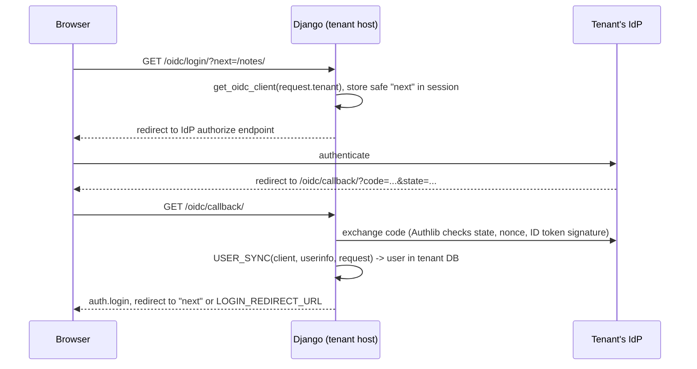

# OIDC strategy

`django_db_tenants.oidc` is an optional [database strategy](../strategies/), `OidcStrategy`, with the views that sign a tenant's users in through that tenant's own [OIDC](../../../glossary/#oidc) provider. The rest of the library does not know how users authenticate: a client with any other strategy uses whatever Django authentication the project sets up (the demo project uses `django.contrib.auth`'s login views with passwords stored in each tenant database).

## Set up

```bash
pip install "django-db-tenants[oidc]"  # Authlib, needed by the views
```

```python
# settings.py
DB_TENANTS = {"DATABASE_STRATEGIES": ["django_db_tenants.oidc.OidcStrategy"]}

# urls.py
urlpatterns = [
    path("oidc/", include("django_db_tenants.oidc.urls")),
]
```

Then give a client `db_strategy = "django_db_tenants.oidc.OidcStrategy"` and its provider in `db_params`, and register `https://<client-domain>/oidc/callback/` as a redirect URI at that provider:

```bash
python manage.py provision_tenant globex --name Globex --db-name globex \
    --db-strategy django_db_tenants.oidc.OidcStrategy \
    --db-params '{"SSO": {"ISSUER": "https://login.microsoftonline.com/<tenant-id>/v2.0", "CLIENT_ID": "...", "CLIENT_SECRET": "..."}}'
```

## `OidcStrategy`

The connection is built, created and dropped exactly as by [`TemplateOverlay`](../strategies/#templateoverlay): `db_params` holds `DATABASES` keys (`ENGINE`, `HOST`, `PORT`, `USER`, `PASSWORD`, `OPTIONS`, ...) and `NAME` is `client.db_name`. The OpenID Connect provider is the `SSO` object:

| `db_params["SSO"]` key | Type | Default | Meaning |
|---|---|---|---|
| `ISSUER` | string, http(s) URL | | Issuer URL; `/.well-known/openid-configuration` is appended for discovery. Required |
| `CLIENT_ID` | string | | Client id registered at the IdP. Required |
| `CLIENT_SECRET` | string | `""` | Client secret (encrypted at rest with the rest of `db_params`) |
| `SCOPES` | string | `"openid email profile"` | Scopes requested at login |
| `AUTO_CREATE_USERS` | boolean | `true` | The default user sync creates a local user on first login |

Empty strings and `null` take the default. A missing `SSO` object, another key, or an `ISSUER` that is not an http(s) URL fails validation.

```json
{
  "HOST": "db2.internal",
  "USER": "globex",
  "PASSWORD": "s3cret",
  "OPTIONS": {"sslmode": "require"},
  "SSO": {"ISSUER": "https://login.microsoftonline.com/<tenant-id>/v2.0", "CLIENT_ID": "...", "CLIENT_SECRET": "..."}
}
```

`OidcStrategy.oidc_config()` returns the provider as an `OidcConfig` (`issuer`, `client_id`, `client_secret`, `scopes`, `auto_create_users`). `get_oidc_config(client)` returns it for a client whose strategy is an `OidcStrategy` (or a subclass), and `None` for any other client: this is how the views, the Authlib client and the user sync find the provider. Override `oidc_config()` in a subclass to take the provider from somewhere else.

## Sign-in flow



The user is found or created **in the tenant database**, because the tenant is active during the callback.

## Views

URL names are in the `db_tenants_oidc` namespace.

| URL | Name | Methods | Behaviour |
|---|---|---|---|
| `login/` | `login` | GET | Redirects to the IdP. A `?next=` URL on the same host is stored in the session |
| `callback/` | `callback` | GET | Exchanges the code (Authlib validates state, nonce and the ID token signature), maps the claims to a user with `USER_SYNC`, logs them in with `AUTH_BACKEND`, stores the ID token in the session, redirects to `next` or `LOGIN_REDIRECT_URL` |
| `logout/` | `logout` | GET, POST | Logs out locally, then performs [RP-initiated logout](../../../glossary/#rp-initiated-logout): redirects to the IdP's `end_session_endpoint` (with `id_token_hint` and `post_logout_redirect_uri`) when `RP_INITIATED_LOGOUT` is on and the IdP advertises one; otherwise to `LOGOUT_REDIRECT_URL` |

| Situation | Response |
|---|---|
| No tenant, or a tenant whose strategy is not an `OidcStrategy` (login, callback) | 404 |
| IdP returned `?error=` to the callback | 400 with the error description |
| User sync returned `None` | 403 |

```html
<a href="?next={{ request.path|urlencode }}">Sign in with your company account</a>
```

## Settings

In the `OIDC` sub-dict of `DB_TENANTS`:

| Key | Type | Default | Meaning |
|---|---|---|---|
| `USER_SYNC` | dotted path or callable | `"django_db_tenants.oidc.sync.default_user_sync"` | `callable(client, userinfo, request) -> user | None`; `None` refuses the login |
| `AUTH_BACKEND` | dotted path | `"django.contrib.auth.backends.ModelBackend"` | Backend recorded in the session by `auth.login` |
| `LOGIN_REDIRECT_URL` | URL | `"/"` | Where `callback/` redirects when no safe `next` was given |
| `LOGOUT_REDIRECT_URL` | URL | `"/"` | Where `logout/` redirects, and the `post_logout_redirect_uri` sent to the IdP |
| `RP_INITIATED_LOGOUT` | `bool` | `True` | On logout, also end the IdP session through its `end_session_endpoint` |

## Map claims to users

`USER_SYNC` turns the IdP's claims into a user of the tenant database. The default, `default_user_sync`:

1. Refuses claims without `email`.
2. Finds the user by e-mail, case-insensitively.
3. Without a match, creates one when `AUTO_CREATE_USERS` is on (username field set to the e-mail, unusable password), otherwise refuses.
4. Copies `given_name` and `family_name` into `first_name` and `last_name` when the model has them.
5. Refuses inactive users; saves and returns the others.

Replace it to restrict domains, map groups, or use another claim:

```python
# myproject/sso.py
from django_db_tenants.oidc.sync import default_user_sync


def sync_user(client, userinfo, request):
    if not userinfo.get("email", "").endswith("@acme.com"):
        return None  # 403
    user = default_user_sync(client, userinfo, request)
    if user is not None and "admins" in userinfo.get("groups", []):
        user.is_staff = True
        user.save(update_fields=["is_staff"])
    return user
```

```python
DB_TENANTS = {..., "OIDC": {"USER_SYNC": "myproject.sso.sync_user"}}
```

The function runs with the tenant active, so its queries use the tenant database.

## Per-tenant OIDC clients

`get_oidc_client(client)` returns an Authlib remote app named `tenant_<slug>`, registered from the client's `OidcConfig`, with discovery metadata cached in the library's `CACHE_ALIAS`. It is registered again when the client's config version, issuer or client id changes. It raises `ValueError` when the client's strategy is not an `OidcStrategy`.

::: django_db_tenants.oidc.strategy

::: django_db_tenants.oidc.client

::: django_db_tenants.oidc.sync

::: django_db_tenants.oidc.views
