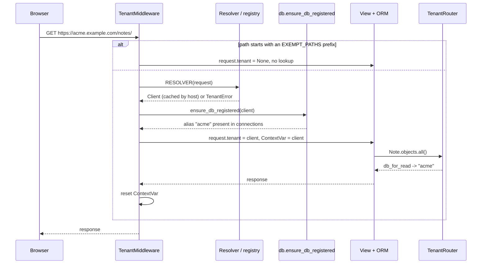
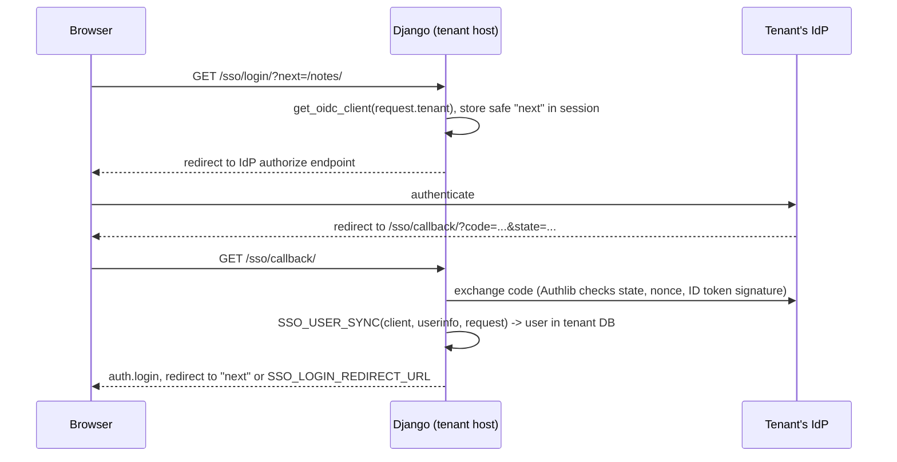

# Architecture

Who is this for: anyone changing the library's core, or debugging why a query went to the wrong database.

TL;DR: a request's host picks a `Client` row in the shared database; the middleware registers that client's database under the alias `client.slug` (if this process has not done so already) and stores the client in a `ContextVar`; the database router sends every query of a non-shared app to that alias. Code outside requests sets the same `ContextVar` with `tenant_context()`.

## Databases

There are two kinds of database:

| Database | Alias | Holds |
|---|---|---|
| [Shared database](../../glossary/#shared-database) | `TEMPLATE_ALIAS` (default `"default"`) | The client registry (`Client`, `ClientDomain`). With `TENANT_APPS_ON_DEFAULT = True` (the default), also a copy of every tenant-app table, so superusers can log in on a [control host](../../glossary/#control-host) |
| [Tenant database](../../glossary/#tenant-database), one per client | `client.slug` | `auth`, `sessions`, `contenttypes`, `admin` and every other app not in `SHARED_APPS` |

The shared database's `DATABASES` entry is also the **template** for tenant connections. How a tenant's connection is derived from it is decided by the client's [database strategy](../../glossary/#database-strategy) (`Client.db_strategy`). The built-in `TemplateOverlay` copies the template and lays the client's `db_params` (host, user, password, options...) over it, so the simplest deployment is many databases on one server, reached with one role.

The [Model reference](../models/) shows which table lives where.

## Request lifecycle

Step by step (`middleware.py`):

1. If `request.path` starts with one of `EXEMPT_PATHS`, the middleware sets `request.tenant = None` and passes the request on. Queries then go to the shared database.
2. Otherwise it calls the configured [resolver](../api/resolvers/). The default, `resolve_by_host`, strips the port, lower-cases the host and returns `None` for control hosts; for any other host it asks the [registry](../api/registry/) for the matching active client.
3. A `TenantError` (`TenantNotFound` or `TenantInactive`) ends the request: with `NOT_FOUND_HANDLER` set, its response is returned; otherwise a plain `404 Unknown tenant.`
4. For a client, `ensure_db_registered(client)` makes sure the alias exists in this process (see [below](#runtime-database-registration)).
5. The middleware sets `request.tenant` and the [tenant context](../../glossary/#tenant-context), calls the rest of the stack, and resets the context in a `finally` block.

The middleware must sit **before** `SessionMiddleware` and `AuthenticationMiddleware`, so that sessions and users are read from the tenant database.

Under ASGI the middleware runs as a coroutine; the resolver and the registration run in `sync_to_async(..., thread_sensitive=True)`, because both may query the database. The context is a `ContextVar`, which follows the request across threads, `asyncio` tasks and asgiref's sync/async bridges.

## Database routing

`TenantRouter` (`router.py`) decides per app label:

| Question | Shared app (`SHARED_APPS`) | Any other app |
|---|---|---|
| `db_for_read` / `db_for_write` | `TEMPLATE_ALIAS` | the active tenant's alias, or `TEMPLATE_ALIAS` when no tenant is active |
| `allow_migrate` on `TEMPLATE_ALIAS` | yes | `TENANT_APPS_ON_DEFAULT` |
| `allow_migrate` on a tenant alias | no | yes |
| `allow_relation` | refused when both objects are saved in different databases; otherwise no opinion | same |

Explicit `.using(alias)` calls bypass the router, as in plain Django.

Consequence: **never add a `ForeignKey` from a tenant app to `Client`**. The two tables live in different databases, and Django cannot follow relations across databases. Store `client.slug` and look the client up with `registry.get_client(slug)`.

## Runtime database registration

Django reads `connections.settings` (also exposed as `connections.databases`) every time it opens a connection, and opens connections lazily. Adding an entry to that dict is enough to make a new alias usable. `ensure_db_registered(client)` in `db.py`:

1. Returns at once when this process already registered the alias with the same [config version](../../glossary/#config-version) (`client.updated_at`). This is the path almost every request takes; it takes no lock.
2. Otherwise, under a process-wide lock, it passes a deep copy of the template entry to the client's database strategy, `client.get_db_strategy().connection_settings(template)`, which returns the tenant's complete settings. With `TemplateOverlay`, that is the template with the client's `db_params` laid over it (`OPTIONS` merged) and `NAME = client.db_name`. It then sets `TEST["NAME"] = None`, whatever the strategy returned, so a test run never reuses the template's test database name. See [Database strategies](../api/strategies/).
3. It stores the entry under `client.slug`, records the version, and closes the connection the current thread may hold for that alias, so new credentials apply at once.

Registration is **per process**. Each worker registers an alias the first time it meets a client; a worker that never served a client holds no entry for it. When a client's row changes (for example a password rotation), `updated_at` changes, every process sees a new config version the next time it gets the client from the registry, and re-registers.

`unregister_db(alias)` closes the current thread's connection and removes the alias; the `post_delete` signal of `Client` calls it.

## Client lookup cache and invalidation

`registry.py` keeps `Client` objects in the cache named by `CACHE_ALIAS`, for `CACHE_TTL` seconds (default 60):

| Key | Value |
|---|---|
| `django_db_tenants:host:<host>` | the client that owns the domain, or a "miss" marker for unknown hosts (negative caching) |
| `django_db_tenants:slug:<slug>` | the client with that slug |

`get_client_for_host()` raises `TenantInactive` for a client that is not `active`. `get_client()` (by slug) does not check the status: `tenant_context("acme")` and `tenant_shell acme` work on suspended clients too.

The signal handlers in `signals.py` delete the affected keys when rows change through the ORM:

| Event | Effect |
|---|---|
| `Client` saved | slug key and every host key of the client deleted |
| `Client` deleted | same, then `unregister_db(client.slug)` in this process |
| `ClientDomain` saved or deleted | host key of that domain, plus every key of its client, deleted |

How fast other processes see a change depends on the cache backend. With a shared cache (Redis, Memcached), the deletion is visible to every process at once. With a per-process cache such as `LocMemCache`, other processes keep their copy until it expires, at most `CACHE_TTL` seconds.

Limits of the invalidation:

- `QuerySet.update()`, raw SQL and changes made outside Django send no signals; the cached entries expire after `CACHE_TTL`.
- When a domain is renamed, the key of the **old** host name is not deleted: it keeps resolving to the client until it expires.

## Code outside requests

Management commands, Celery or RQ tasks, cron jobs and shells never pass through the middleware, so no tenant is active and every query goes to the shared database. They name their tenant explicitly:

| Tool | Use |
|---|---|
| `tenant_context(client_or_slug)` | Context manager; `None` activates the shared database |
| `@with_tenant` | Decorator for task functions that take `tenant` (slug or `Client`) as first argument or keyword |
| `for_each_tenant(func)` | Runs `func(client)` for every active client (or every client) inside its context |
| `tenant_shell <slug>` | Django shell with the tenant active |

See [Background tasks](../api/tasks/) and [Context](../api/context/).

## Provisioning

`provision(client)` (`provisioning.py`) onboards a client in three idempotent steps:

1. `create_database()` asks the client's database strategy to create the database. `TemplateOverlay` does it on the server and with the account of the tenant's own connection settings, which needs the right to create databases:
    - PostgreSQL: connects to the maintenance database (`db_params["MAINTENANCE_DB"]`, default `postgres`), checks `pg_database`, runs `CREATE DATABASE`.
    - MySQL: connects without a default database, `CREATE DATABASE IF NOT EXISTS ... CHARACTER SET utf8mb4`.
    - SQLite: nothing; the file appears on first connection.
    - Any other vendor: `NotImplementedError`.
2. `migrate_tenant()` registers the alias and runs `migrate --database=<slug>`.
3. The client's status becomes `active`, which makes it resolvable by host.

The [`provision_tenant`](../cli/provision-tenant/) command and the admin action **Provision database** both call `provision()`. The reverse, `drop_database(client)`, closes the current thread's connection to the tenant and asks the strategy to drop the database; the client row is left alone.

## Single sign-on

With `Client.sso_enabled`, the views in `sso/views.py` sign users in through the client's own OpenID Connect provider:

- `sso/oidc.py` keeps one Authlib OAuth registry per process and registers one remote app per tenant (`tenant_<slug>`) from the `Client` row. The provider metadata comes from `<oidc_issuer>/.well-known/openid-configuration` and is cached in `CACHE_ALIAS`. The app is registered again when the client's config version, issuer or client id changes.
- The user is found or created **in the tenant database**, because the tenant is active during the callback.
- `/sso/logout/` logs out locally, then performs [RP-initiated logout](../../glossary/#rp-initiated-logout) when it is enabled, an ID token is in the session and the provider advertises `end_session_endpoint`.

Each IdP must list `https://<client-domain>/sso/callback/` as a redirect URI. Details: [SSO API](../api/sso/).

## Secrets at rest

`Client.db_params` (an `EncryptedJSONField`, holding the database password among the strategy parameters) and `Client.oidc_client_secret` (an `EncryptedTextField`) are Fernet-encrypted when written and decrypted when read. The key is `ENCRYPTION_KEY`, or one derived from `SECRET_KEY` when it is unset. See [Encryption](../api/encryption/).

## Cache isolation

Tenants share the cache servers. `cache.tenant_key_func`, set as a cache's `KEY_FUNCTION`, puts the active tenant's alias in every key (`<prefix>:<version>:@<slug>:<key>`), leaves keys written without a tenant in Django's default format, and never namespaces the registry's own `django_db_tenants:` keys. See [Cache isolation](../api/cache/).

## Known constraints

- **One connection per tenant per worker.** A worker keeps a connection for each tenant it served, subject to `CONN_MAX_AGE`. For many tenants, keep `CONN_MAX_AGE` low or use a pooler such as PgBouncer.
- **The slug is permanent.** It is the database alias, a cache namespace and part of the OIDC app name; the admin makes it read-only after creation. `default` and the template alias are reserved (`Client.clean()`).
- **Streaming responses.** The context is reset when the view returns. The body of a `StreamingHttpResponse` is produced after that, so queries made while streaming run without the tenant (on the shared database) unless the generator activates it with `tenant_context()`.
- **No cross-database relations.** See [Database routing](#database-routing).
- **Secrets in the cache.** The registry caches whole `Client` objects, pickled, in `CACHE_ALIAS`: the cached copy holds `db_params` (database passwords included) and the OIDC client secret **decrypted**. Use a cache that only the application can reach, with authentication and TLS where the network is shared.

## Next steps

- Field-level details: [Model reference](../models/).
- Every setting mentioned here: [Settings](../api/settings/).
