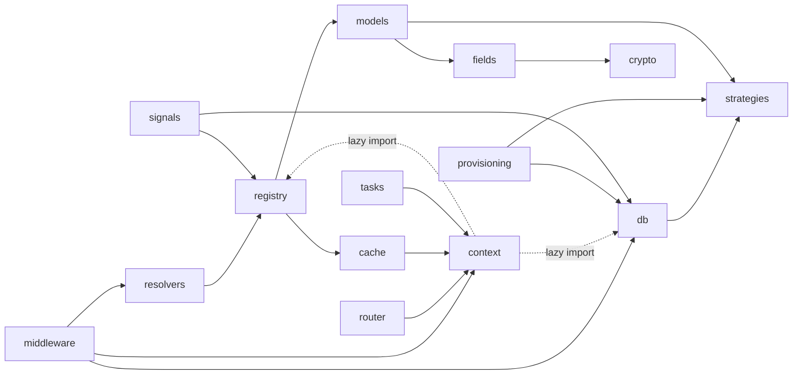

# Codebase structure

Who is this for: contributors looking for the right place to make a change.

## Repository layout

```text
src/django_db_tenants/        the library (the only package that ships)
tests/                        pytest suite
tests/_extra/testutils/       test utilities, importable as `testutils`
tests/demo/                   example Django project, importable as `demo` and `notes`
docs/                         this site (Zensical)
```

## The library: `src/django_db_tenants`

| Module | Responsibility | Reference |
|---|---|---|
| `__init__.py` | Public entry points: `get_current_tenant`, `get_current_tenant_alias`, `tenant_context`, `ensure_db_registered`; `__version__` | [API reference](api/index.md) |
| `apps.py` | `AppConfig` (`label = "django_db_tenants"`, `BigAutoField`); connects the signal handlers and registers `DATABASE_STRATEGIES` in `ready()` | |
| `conf.py` | `DB_TENANTS` settings with defaults; dotted paths are imported on access | [Settings](api/settings.md) |
| `context.py` | The [tenant context](../glossary.md#tenant-context) (`ContextVar`) and `tenant_context()` | [Context](api/context.md) |
| `middleware.py` | `TenantMiddleware`: resolves the tenant of each request, sync and async | [Middleware](api/middleware.md) |
| `resolvers.py` | `resolve_by_host`, `resolve_by_header` | [Resolvers](api/resolvers.md) |
| `router.py` | `TenantRouter`: shared apps to the shared database, the rest to the active tenant | [Router](api/router.md) |
| `db.py` | [Runtime registration](../glossary.md#runtime-registration) of tenant connections | [Database registration](api/db.md) |
| `strategies.py` | [Database strategies](../glossary.md#database-strategy): the `DbConnectionFactory` protocol, `DatabaseStrategy`, the built-in `TemplateOverlay` (connection settings, create and drop per backend), the strategy `registry` | [Database strategies](api/strategies.md) |
| `registry.py` | Cached `Client` lookups by host and by slug, cache invalidation | [Registry](api/registry.md) |
| `signals.py` | Invalidates the registry cache and unregisters connections when `Client` / `ClientDomain` rows change | [Architecture](architecture.md#client-lookup-cache-and-invalidation) |
| `models.py` | `Client`, `ClientDomain` | [Model reference](models/index.md) |
| `fields.py`, `crypto.py` | `EncryptedTextField`, `EncryptedJSONField` and the Fernet helpers behind them | [Encryption](api/encryption.md) |
| `provisioning.py` | `create_database`, `migrate_tenant`, `provision`, `drop_database`, delegating to the strategy | [Provisioning](api/provisioning.md) |
| `tasks.py` | `with_tenant`, `for_each_tenant` for background work | [Background tasks](api/tasks.md) |
| `cache.py` | `tenant_key_func`: per-tenant cache key namespaces | [Cache isolation](api/cache.md) |
| `exceptions.py` | `TenantError`, `TenantNotFound`, `TenantInactive` | [Exceptions](api/exceptions.md) |
| `admin.py` | `ClientAdmin` with the domain inline and the provisioning action | [Admin](api/admin.md) |
| `management/commands/` | `provision_tenant`, `migrate_tenants`, `tenant_shell` | [CLI reference](cli/index.md) |
| `migrations/` | Schema of `Client` and `ClientDomain` (shared database only) | |
| `py.typed` | Marks the package as typed (PEP 561) | |

### How the modules depend on each other



Every module reads its settings through `conf.app_settings`. `context.py` imports `db` and `registry` inside `tenant_context()` because `registry` imports the models, which must not load before the app registry is ready.

## Test utilities: `tests/_extra/testutils`

| Module | Contents |
|---|---|
| `settings.py` | Test settings: the demo's settings plus the selected database backend, a fast password hasher, a tenant-namespaced `LocMemCache`, a fixed `ENCRYPTION_KEY`, `CONTROL_HOSTS = ["control.test"]`, the `EnvironmentPassword` strategy |
| `databases.py` | `TEST_DB` backend selection and `.env` loading |
| `plugin.py` | pytest fixtures: `tenant_factory`, `acme`, `globex`, `tenant_db_name`, `tenant_template_db`, plus two autouse fixtures |
| `tenants.py` | Creating, cloning and dropping tenant databases per backend; `reset_tenant_state()`, `tenant_login()` |
| `factories.py` | factory_boy factories: `ClientFactory`, `ClientDomainFactory`, `UserFactory`, `NoteFactory` |
| `strategies.py` | `EnvironmentPassword`, a custom database strategy registered by the test settings, and `Unregistered`, one that is not |

See [Testing strategy](testing.md) for how they fit together.

## Demo project: `tests/demo`

| Path | What it shows |
|---|---|
| `demo/settings.py` | Every setting the library needs, marked `# django-db-tenants` |
| `demo/urls.py` | Django's own login views (`django.contrib.auth.urls`): tenant users log in with a password stored in their tenant database |
| `demo/views.py` | `request.tenant`, `get_current_tenant()`, a health check on an [exempt path](../glossary.md#exempt-path) |
| `notes/` | An ordinary app whose tables live in every tenant database |
| `notes/tasks.py` | Background jobs with `@with_tenant` and `for_each_tenant` |
| `notes/management/commands/seed_demo.py` | Onboarding tenants with `provision_tenant` |
| `notes/management/commands/notes_report.py` | Reading every tenant database from one command |

## Configuration files

| File | Configures |
|---|---|
| `pyproject.toml` | Package metadata, runtime dependencies (Django, cryptography, django-strategy-field) and extras (`postgres`, `mysql`), dependency groups, setuptools package discovery, Commitizen (`[tool.commitizen]`) |
| `uv.lock` | Locked versions of every dependency; kept current by the `uv-lock` hook |
| `ruff.toml` | Lint rules and formatting (line length 120, target Python 3.11) |
| `ty.toml` | Type checking: Python 3.11, extra import paths, per-file overrides |
| `pytest.toml` | pytest and pytest-django: test paths, Python path, settings module, strict options, warnings as errors |
| `.coveragerc.toml` | coverage.py: source package, branch coverage, report options |
| `tox.ini` | The Python × Django × database matrix plus `lint`, `type` and `docs` |
| `.github/workflows/ci.yml` | GitHub Actions: every tox environment, the package build ([CI/CD and build](ci-cd.md#github-actions)) |
| `.github/workflows/docs.yml` | GitHub Actions: builds this site from `develop` and publishes it on GitHub Pages ([Publish the documentation](ci-cd.md#publish-the-documentation)) |
| `.github/workflows/cla.yml` | GitHub Actions: the Contributor License Agreement check on pull requests (`CLA.md`), signatures stored on the `cla-signatures` branch |
| `.github/workflows/release.yml` | GitHub Actions: PyPI upload and GitHub release of a pushed `v*` tag (see `RELEASE.md`) |
| `.pre-commit-config.yaml` | Git hooks, on `pre-commit` and `commit-msg` |
| `zensical.toml` | This site: navigation, theme, Markdown extensions, mkdocstrings options |
| `tools/check_zensical_nav.py` | Pre-commit hook: every docs page is in the `nav` of `zensical.toml` |
| `docker-compose.yml` | PostgreSQL and MySQL for the server test backends |
| `.env.example`, `.envrc.example` | Templates for the local environment files |
| `.editorconfig` | Indentation, line endings, final newline |
| `.python-version` | Python version uv uses for the project environment (3.13) |

## Next steps

See how the pieces work together in [Design overview](design-overview.md), and at runtime in [Architecture](architecture.md).
