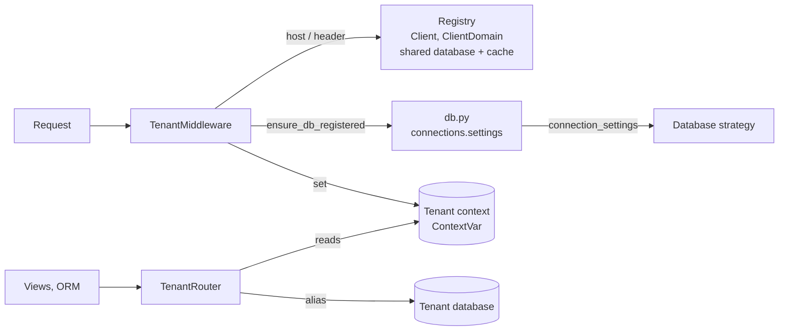

# Design overview

Who is this for: anyone meeting the library for the first time who wants the idea before the details.

TL;DR: every [tenant](../glossary.md#tenant) has its own physical database, and application code stays plain Django. A [tenant context](../glossary.md#tenant-context) holds the current tenant; a database router sends every query to that tenant's alias; the alias is added to `django.db.connections` the first time a process needs it, with connection settings built by the tenant's [database strategy](../glossary.md#database-strategy).

## The five pieces



### 1. The registry of tenants lives in the shared database

`models.py`, `registry.py`.

- A `Client` row describes one tenant: its `slug`, which is also its database alias; its `db_name`; its `db_strategy`, the class that builds its connection settings; and `db_params`, that class's encrypted parameters.
- A `ClientDomain` row maps a host name to a client.
- These tables exist only in the [shared database](../glossary.md#shared-database), the [template alias](../glossary.md#template-alias) (`DB_TENANTS["TEMPLATE_ALIAS"]`, default `"default"`).
- Lookups go through the cache (`registry.get_client_for_host()` and `get_client()`), including negative results ("no such host"), so requests do not hit the shared database every time.

### 2. The tenant context is a `ContextVar`

`context.py`.

- It holds the active `Client`, or `None` for the shared database.
- It is a `ContextVar` rather than a thread-local, so it stays correct under threads, asyncio and asgiref's `sync_to_async`.
- Everything else reads it through `get_current_tenant()` and `get_current_tenant_alias()`.
- `tenant_context("acme")` sets it for a block of code.

### 3. The middleware decides the tenant for each request

`middleware.py`, `resolvers.py`.

- `TenantMiddleware` calls the configured [resolver](api/resolvers.md):
    - `resolve_by_host` (the default) maps `acme.example.com` to its `ClientDomain`; [control hosts](../glossary.md#control-host) get `None`;
    - `resolve_by_header` reads the slug from `X-Tenant` instead.
- It then registers the tenant's database, sets the context for the request, and resets it afterwards.
- An unknown host gets a 404, or the response of `NOT_FOUND_HANDLER`. [Exempt paths](../glossary.md#exempt-path) such as `/healthz` skip all of this.
- It must sit **before** the session and auth middleware: sessions and users are tenant data, so they are looked up only once the context points at the tenant.

### 4. Databases are registered at runtime

`db.py`.

- Django reads `connections.settings` each time it opens a connection, and opens connections lazily. Adding a key to that dict is enough to create a usable alias: no restart, nothing listed in `DATABASES`.
- `ensure_db_registered(client)` takes a deep copy of the template alias's settings, asks the strategy for the tenant's settings (`client.get_db_strategy().connection_settings(template)`), and stores the result under `client.alias`.
- Registration happens once per process per tenant, under a lock.
- `Client.config_version()` comes from `updated_at`. When a client row changes, for example after a password rotation, each process sees a new version and re-registers. It also closes the connection the current thread holds, so the new settings take effect at once.

### 5. The router enforces where data goes

`router.py`. `TenantRouter` is the only place that decides where queries go:

| Model's app | `db_for_read` / `db_for_write` |
|---|---|
| In `SHARED_APPS` (default: only `django_db_tenants`) | the template alias, always |
| Anything else (auth, sessions, contenttypes, your apps) | the current tenant's alias, or the template alias when there is no tenant |

- `allow_relation` refuses relations between objects saved in different databases.
- `allow_migrate` keeps shared tables out of tenant databases. Tenant tables also go into the shared database when `TENANT_APPS_ON_DEFAULT` is on, so superusers can log in on a control host.

## How a request flows

```text
GET https://acme.example.com/notes/
 │
 ├─ TenantMiddleware
 │    resolve_by_host → registry (cache, else shared DB) → Client "acme"
 │    ensure_db_registered(acme) → strategy builds settings → connections.settings["acme"] = {...}
 │    context = acme
 │
 ├─ SessionMiddleware / AuthenticationMiddleware ─┐
 ├─ view: Note.objects.all() ─────────────────────┤→ TenantRouter → "acme" → acme's database
 │                                                ┘
 └─ finally: context reset
```

[Architecture](architecture.md#request-lifecycle) has the full sequence, including the exempt-path and error branches and the ASGI path.

## The strategy decides how a database is reached

`db.py` and `provisioning.py` do not know how a tenant's database is reached. They call the strategy through the `DbConnectionFactory` interface: `connection_settings()`, `create_database()`, `drop_database()` and `validate()`.

The built-in `TemplateOverlay` lays `db_params` (`HOST`, `USER`, `PASSWORD`, `OPTIONS`...) over the template connection and uses `client.db_name` as `NAME`. Tenants can therefore live on the same server as the shared database, on other servers, or on another engine. A custom strategy can get credentials elsewhere: the test suite's `EnvironmentPassword` reads the password from an environment variable. See [Database strategies](api/strategies.md).

## The supporting pieces

- **Code outside requests.** `tenant_context()` and `@with_tenant` for tasks, `for_each_tenant()` to loop over tenants, and the `tenant_shell` and `migrate_tenants` commands. They all set the same context, so the router behaves identically. See [Background tasks](api/tasks.md).
- **Cache isolation.** `tenant_key_func` adds `@<alias>` to cache keys while a tenant is active, so two tenants caching the same key do not read each other's data. The registry's own keys are always shared. See [Cache isolation](api/cache.md).
- **Staying consistent.** Saving a `Client` or `ClientDomain` clears its cached lookups (`signals.py`), and deleting a client unregisters its alias. Other processes pick up changes when their cache entry expires, or through the config version. See [Client lookup cache and invalidation](architecture.md#client-lookup-cache-and-invalidation).
- **Onboarding.** `provision()` creates the database through the strategy, runs migrations on the new alias and marks the client active. See [Provisioning](api/provisioning.md).

## What the design accepts

- **Connections grow with tenants.** A process holds a connection for every tenant it has served, so the number of registered aliases grows with the tenants it meets, and connection limits on the database server need planning.
- **No cross-database queries.** Anything with a foreign key to `auth.User` or `contenttypes` must be a tenant app, which is why `SHARED_APPS` is deliberately tiny.
- **Isolation depends on the context being set.** Code that runs with no tenant falls back to the shared database rather than failing. That is why the middleware runs early, and why background code must use `tenant_context()` or `@with_tenant`.

[Known constraints](architecture.md#known-constraints) lists the remaining limits.

## Next steps

Follow a request, a task and a command through the code in [Architecture](architecture.md).
