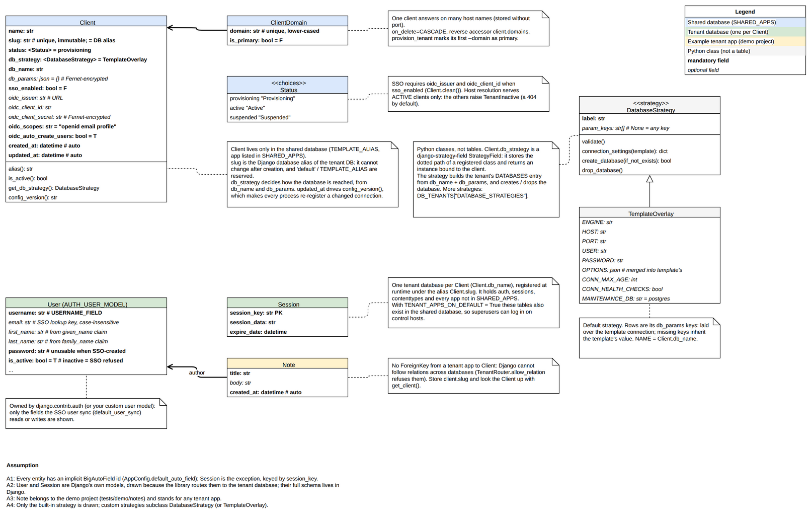

# Model reference

Who is this for: developers who read or change the library's models, or who design tenant apps around them.

The library ships two models, both in the [shared database](../../glossary/#shared-database). Everything else a request touches (users, sessions, your apps' tables) lives in the [tenant database](../../glossary/#tenant-database) and belongs to Django or to your project.

| Model | Purpose | Page |
|---|---|---|
| `Client` | One tenant: identity, status, database connection, SSO settings | [Client](client/) |
| `ClientDomain` | A host name that resolves to a client | [ClientDomain](client-domain/) |

## Data model diagram

The diagram also shows the database strategy classes behind `Client.db_strategy`, Django's `User` and `Session`, because the library routes them to the tenant database and the SSO user sync reads and writes `User`, and the demo project's `Note`, as an example of a tenant-app table. Only the fields that matter to the library are drawn for them.

### How to read it

- Every entity has an implicit `id` primary key, not drawn. A different primary key is drawn bold with `PK` (`Session.session_key`).
- **Bold** rows are mandatory fields, *italic* rows optional ones (`blank=True`). `= value` is the default; `T` / `F` stand for `True` / `False`.
- `<Status>` is a field typed by the `<<choices>>` box of the same name (`Client.Status`).
- An arrow is a foreign key, pointing at the referenced entity; a 2 px line is a mandatory foreign key. The key column is named after the target (`ClientDomain` to `Client` is `client_id`) unless the arrow has a label (`author`).
- The bottom compartment of `Client` lists computed values (properties and methods).
- `<<strategy>>` boxes are Python classes, not tables: the [database strategies](../api/strategies/) a client can use through `db_strategy`. `TemplateOverlay` inherits from `DatabaseStrategy` (hollow-triangle arrow); its rows are the `db_params` keys it accepts.
- Colours mark the database a table lives in; the legend in the top-right corner explains them.

### Edit the diagram

`data-model.drawio.png` is an editable PNG: the image carries the draw.io source. To change it:

1. Open `docs/development-guide/models/data-model.drawio.png` in [draw.io](https://app.diagrams.net/) (desktop app, web app or the IDE plugins).
2. Edit it, keeping the conventions above.
3. Choose **File > Export as > PNG**, tick **Include a copy of my diagram**, and overwrite the same file.

`*.drawio.png` files are excluded from the `check-added-large-files` hook, so the diagram can grow past its 500 KB default.

Update the diagram in the same change as the model, and regenerate the migration (see [Contribution guidelines](../contributing/#change-a-model)).

## Where tables live

| Table | Shared database | Tenant database |
|---|---|---|
| `django_db_tenants_client`, `django_db_tenants_clientdomain` | yes | never |
| Tenant-app tables (`auth_*`, `django_session`, `django_content_type`, your apps) | when `TENANT_APPS_ON_DEFAULT = True` (default) | yes |

The [router](../api/router/) enforces this through `allow_migrate`, so `migrate` on the shared database and [`migrate_tenants`](../cli/migrate-tenants/) on the tenants create exactly these tables.

## Next steps

Read the field-by-field reference of [Client](client/).
